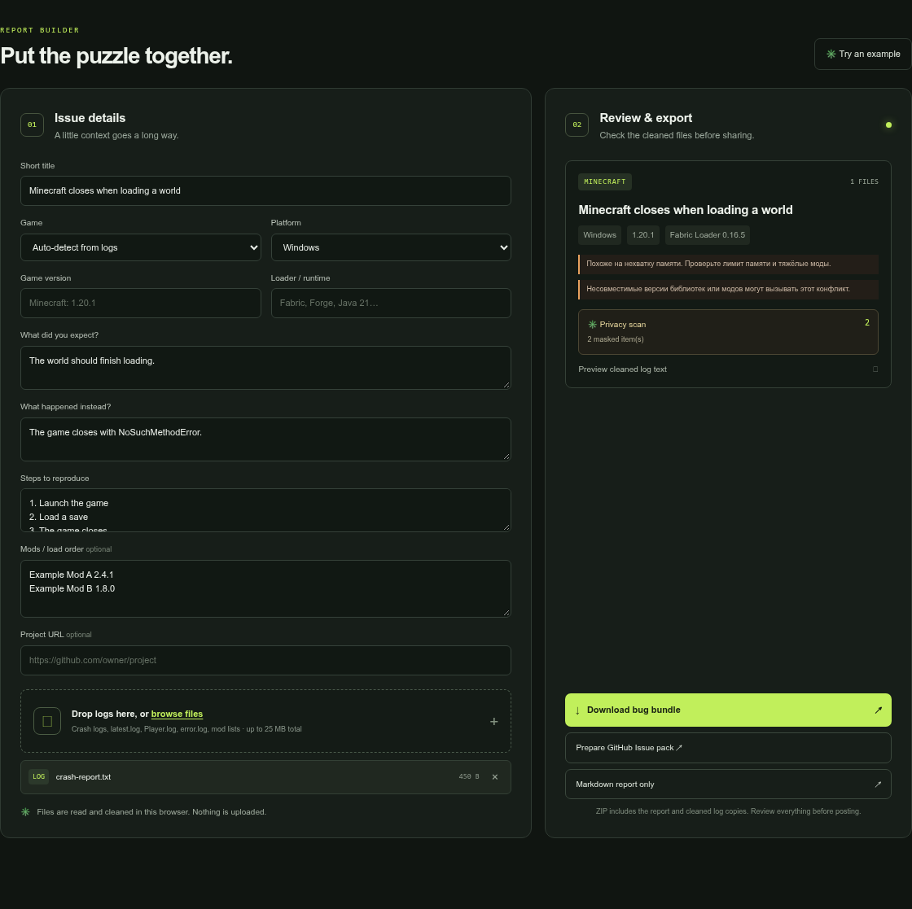

# BugBundle

**Prepare a useful game or mod bug report without sending your logs to a service.** BugBundle gathers selected text logs, versions, a mod list, and reproduction steps into a Markdown report or ZIP bundle. Files are read, redacted, previewed, and packaged in your browser.

> BugBundle is a report-preparation tool. It does not upload or diagnose logs, and its signature hints are not a root-cause analysis. Review every generated report before sharing it.

## Open the app

**Use BugBundle online:** https://ghostnever-lkm.github.io/bugbundle/

**Download for offline use:** [BugBundle v1.0.11 ZIP](https://github.com/GhosTnever-lkm/bugbundle/releases/download/v1.0.11/BugBundle-v1.0.11.zip). Extract it, start a static server in the extracted folder, then open `http://localhost:8000`. For example, run `python -m http.server 8000 --bind 127.0.0.1` and stop it with Ctrl+C when you are done. Keep the server bound to localhost; the app itself does not upload your files.

 ·  · 

Serve this directory with any static web server and open the local HTTP address it prints. For example, from this folder run `python -m http.server 8000 --bind 127.0.0.1` and open `http://localhost:8000`. There is no build step, package install, server API, or account. The example works without selecting a file. A local HTTP server is required because browsers block JavaScript modules loaded directly from `file://` pages.

## What it does

- Reads selected text logs and report files in the browser (up to 8 MB per file and 25 MB total).
- Tries to identify Minecraft, Hearts of Iron IV, Stellaris, Skyrim / Bethesda, Unity, and Unreal logs.
- Extracts a small set of common version fields, error lines, and heuristic starting checks.
- Masks several common token and credential formats, email addresses, user-folder paths, and optionally detected IPv4 addresses in the text that is exported.
- Shows the cleaned log preview and a count of replaced items before export.
- Produces `bug-report.md` or a ZIP containing that report and sanitized copies of the selected text files.
- Produces a GitHub Issue handoff ZIP with a cleaned project context, report, and optional cleaned logs.
- Keeps distinct logs with the same filename by adding a readable number to the exported copy, so ZIP entries do not overwrite one another.
- Includes English and Russian interfaces.

## Privacy and limitations

All processing is client-side. The app contains no analytics, external fonts, or third-party scripts. It does not send files to the GitHub Pages host or to an AI service. GitHub Pages serves only the static app files when you open the hosted version.

Redaction is pattern-based: it removes credentials embedded in HTTP URLs and cannot guarantee that all other sensitive information is found. Check the preview and downloaded bundle yourself. Selected `.dmp` and other binary crash dumps are intentionally not accepted as text logs. Large log sets beyond the limits are rejected. The hints are common-pattern matches, can be wrong, and cannot confirm a cause. Mod formats, game logs, and loader versions vary. Do not use the output as proof that a file is safe or as a substitute for a game's own support instructions.

The GitHub Issue pack is an offline handoff ZIP; it does not publish an issue or contact GitHub. Credentials are removed and recognized secret query parameters are masked in project links. Review the Markdown, project link, and every cleaned log before attaching the files to an issue.

## Development

The app uses native browser JavaScript modules and has no runtime dependencies. Core tests use Node.js's built-in test runner: run `npm test`. Serve the folder locally, edit `index.html`, `styles.css`, or `src/`, and reload the page. GitHub Actions runs the core tests for pushes and pull requests.

## Локальный запуск

Запусти любой статический веб-сервер в этой папке и открой его локальный HTTP-адрес. Например, выполни `python -m http.server 8000 --bind 127.0.0.1` и перейди на `http://localhost:8000`. Просто открыть `index.html` двойным щелчком нельзя: браузеры блокируют загрузку JavaScript-модулей через `file://`. Сборка и установка пакетов не нужны. Пример отчёта работает без выбора файла.

BugBundle собирает текстовые логи, версии, список модов и шаги воспроизведения в Markdown-отчёт или ZIP. Файлы обрабатываются только в браузере. Программа не отправляет логи и не определяет настоящую причину сбоя. Проверка личных данных основана на шаблонах и не гарантирует, что найдёт каждую чувствительную строку. Перед публикацией проверь предпросмотр и скачанный пакет самостоятельно.

Интерфейс принимает до 8 МБ на файл и до 25 МБ файлов всего. Двоичные дампы памяти не поддерживаются. Подсказки по сигнатурам ошибок — ориентир для дальнейшей проверки, а не подтверждённый диагноз.

## ☕ Support / Pro Version

BugBundle is free and open source. There is no paid Pro edition yet. If the tool is useful, support its development on [Buy Me a Coffee](https://buymeacoffee.com/azizazimov8), [Boosty](https://boosty.to/azizazimov), or [GitHub Sponsors](https://github.com/sponsors/GhosTnever-lkm).

You can also send a supported asset to one of these public receive addresses:

| Network | Asset standard | Address |
|---|---|---|
| Bitcoin | BTC | `bc1qn75pj4n7gyl2k5kf2f97elvyenz52q6nn2g30u` |
| Tron | TRC-20 | `TCBSy38X57hA6w2onJcxom24x1febc1mP1` |
| BNB Smart Chain | BEP-20 | `0xD431a917961E0b086B96D9F72b5C8fF19b19068a` |

**Send funds only on the matching network.** Do not send a different network's asset to these addresses.

## Contact

- GitHub: [GhosTnever-lkm](https://github.com/GhosTnever-lkm)
- Email: <azizazimov038l@gmail.com>

## License

MIT. See [LICENSE](LICENSE).
